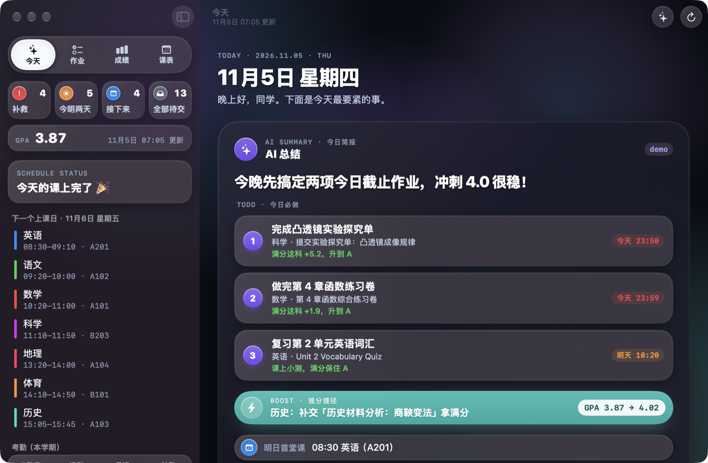
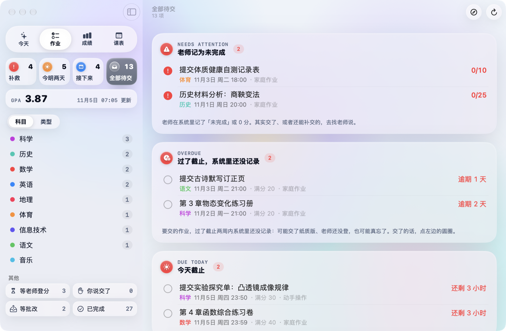
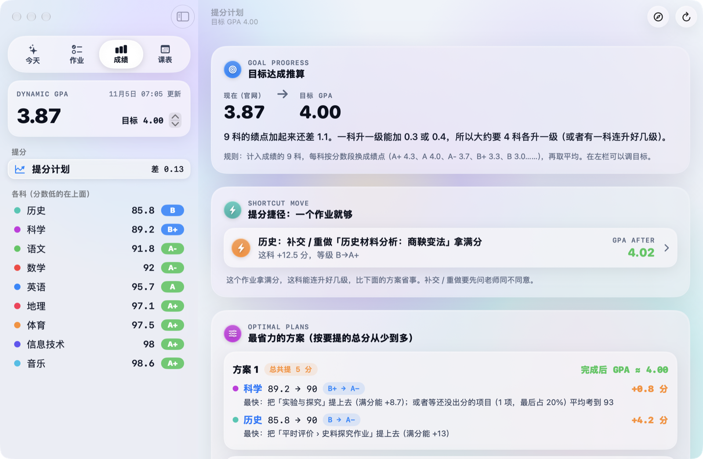
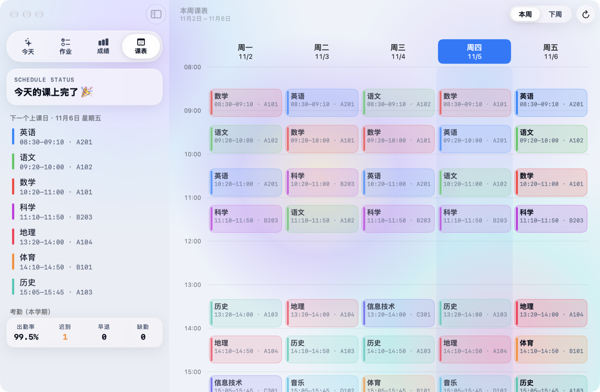

# 学习助手（Schoolis Helper）

一个原生的 macOS 学习管理工具（Swift 6 + SwiftUI，macOS 26+），从学校的校宝（Schoolis）系统只读地同步作业、动态成绩、课表与考勤，按学校规则推算 GPA 提分方案，并用 AI 生成每日学习简报。




| 作业待办 | 动态成绩与提分计划 | 本周课表与考勤 |
| :---: | :---: | :---: |
|  |  |  |

---

## 功能

### 1. 作业待办与「登分格子」识别
- **智能列表分组**：左侧边栏按紧急程度分为「补救」（老师记为未完成，或已批改但得 0 分）、「今明两天」、「接下来」（7 天内与更晚）和「全部待交」；底部「其他」收纳「等老师登分」、「你说交了」、「等批改」和「已完成」。
- **识别「登分格子」与课堂任务**：很多学校任务其实是老师在课后建的「登分格子」（开始时间与截止时间几乎相同），或是随堂测验、笔记本检查、课堂展示、课堂表现与考勤。这类任务过了截止时间还没有分数，只是老师还没登分，并不代表学生没交。程序会自动把它们归入「等老师登分」，避免假警报。
- **纸质作业自报**：已经线下交了纸质版、但老师还没在系统里登记时，点一下作业左侧的圆圈即可标记为「我交了」（只记在本机，不改动学校系统；老师登分后自动归入已完成）。

### 2. 作业类型统一
- 不同学科老师填写的任务类型往往中英文混杂、叫法不一（如 `General Homework`、`家庭作业`、`每周小结`、`Quiz`、`小测试` 等）。
- 程序会先识别作业标题里的关键词，再结合老师填写的原始类型，把所有任务统一归为六大类：**测验考试、作业练习、项目作品、课堂表现、考勤、其他类型**。侧边栏支持按「科目 | 类型」切换浏览，每行末尾仍保留老师填写的原始类型名称以便核对。

### 3. 动态成绩与 GPA 提分计划 / 捷径
- **成绩构成还原**：拉取各科动态总分、等级换算表与多层评价项目树，并将每项作业归入对应的评价项目。
- **提分捷径与省力方案**：在左侧设定目标 GPA 后，自动搜索最多同时提高 3 科的组合方案，按需要提升的总分从少到多排序；如果有单个待交或低分作业拿满分就能直接跨级达标，会单独列出「提分捷径：一个作业就够」。
- **单科涨分杠杆与未出分推算**：点进单科可查看每个待交作业、低分作业或薄弱项目对总分和等级的具体影响（如拿满分 `+x` 分、不交 `−y` 分），以及期中、期末等未出分项目平均需要考到多少分才能保级或升级。

### 4. 课表与考勤
- **双周课表**：支持切换查看本周与下周课表，时间轴高亮今天并绘制当前时间红线，左侧栏实时提示「正在上 / 下一节」及剩余分钟数。
- **学期考勤统计**：展示本学期总体出勤率，以及各科的正常出勤、迟到、早退、缺勤次数和分科出勤率。

### 5. AI 今日简报与多模型接力
- 打开 App 的「今天」页，AI 会结合当天的待办、GPA 提分动作、课表和考勤，生成结构化的今日简报卡片（紧急警报、今日必做、提分捷径、下次上课预告、学习贴士）。
- **去重不啰嗦**：已经提醒过的过期事项会记录在本机，不会每天重复念叨；周末或放假不上学时，不会建议「今天去找老师」。
- **多模型自动接力**：按 `Antigravity CLI (agy) → Gemini API Key → 智谱 GLM API Key → 本地模型` 的顺序自动尝试；下方同时展示程序直接算出的准确数据卡片，方便与 AI 简报对照。

### 6. 提醒与菜单栏常驻
- 屏幕顶部菜单栏常驻图标与紧急待办数字，点开即可在小面板里快速浏览待交作业、触发同步或打开主窗口；关掉主窗口不会退出后台同步。
- 支持每日定时自动同步（通过 macOS `LaunchAgent` 在后台静默唤醒，合盖睡眠错过后会在唤醒一分钟内补跑）。
- 「紧急提醒」（今明两天截止、新出现的作业）和「同步后的汇总」可分别设置为弹窗提醒、系统通知或只更新菜单栏数字。

### 7. VITRA 光学玻璃视觉
- 界面采用自制的 VITRA 光学玻璃视觉系统，支持浅色（白昼）与深色（暗夜）两套配色并随系统外观自动切换。
- 包含动态漫射光球画布、多层磨砂玻璃面板、非对称高光边框、窗口级统一物理光源跟随，以及带弹性阻尼的按钮交互动画（开启系统「减弱动态效果」时自动关闭动画）。

---

## 环境要求

- **系统**：macOS 26.0 或更高版本
- **编译工具**：Command Line Tools for Xcode（自带 Swift 6，**不需要安装完整版 Xcode**）
- **Python 3**（可选，仅生成演示数据时需要）

检查命令行工具是否已就绪：

```bash
swift --version
```

若尚未安装，可在终端运行 `xcode-select --install` 按提示完成安装。

---

## 快速开始

### 1. 克隆并打包安装

在项目根目录下运行打包脚本，程序会编译 Release 版本并安装到 `~/Applications/学习助手.app`：

```bash
git clone https://github.com/cealias/schoolis-helper.git
cd schoolis-helper
./scripts/build-app.sh
```

### 2. 先用演示模式体验（可选）

如果还没有配置账号，或者只想先看看界面效果，可以用脚本生成一套虚构的演示数据：

```bash
python3 scripts/make-demo-data.py Demo
open ~/Applications/学习助手.app --args --data-dir "$PWD/Demo"
```

演示模式下不会登录校宝、不会联网同步，也不会安装后台定时任务。

### 3. 配置校宝账号

1. 正常打开 `~/Applications/学习助手.app`，按 `⌘,`（或从菜单栏点「学习助手 → 设置…」）打开设置窗口。
2. 在「校宝账号」一栏填写：
   - **学校校宝网址**：例如 `https://你的学校.schoolis.cn`
   - **账号**：你的校宝学生端登录名
   - **密码**：保存到 macOS 钥匙串（服务名 `schoolis-helper`，不会写入任何配置文件或日志）
   - **首页称呼**：显示在「今天」页问候语里的名字
3. 点击右上角的同步按钮，即可拉取本学期数据。第一次同步成绩时需要读取作业详情以建立评价项目映射，大约需要 1 分钟；之后的同步只会增量读取新发布的作业。

---

## AI 设置

在「设置 → AI」中可以配置用来写每日简报的模型。程序支持以下几种方式，并可按顺序自动接力（前一个未配置或连接失败时自动尝试下一个）：

1. **Antigravity CLI（`agy`，可选）**：如果本机安装了 `agy` 并已登录，程序可直接调用，无需填写 API Key。
2. **Google Gemini API Key**：在设置中粘贴 API Key（加密保存在 macOS 钥匙串，服务名 `schoolis-helper-ai`），可选模型与思考程度。
3. **智谱 GLM API Key**：国内网络可直接连接，支持免费的 `glm-4.7-flash` 等模型。
4. **本地模型（OpenAI 兼容接口）**：支持任意提供 OpenAI `/v1/chat/completions` 兼容接口的本地推理服务，例如：
   - Ollama（如 `http://127.0.0.1:11434/v1`）
   - `llama.cpp` 的 `llama-server`
   - LM Studio 等
   - 在设置里填写接口地址与模型名，还可以可选填写一个**启动脚本路径**：如果写简报时本地推理服务还没开，App 会在后台运行该脚本启动服务，写完简报后自动关掉以释放内存。
   - **当选择「本地模型」时，所有数据只在你自己的电脑上处理，绝不会发送到任何云端服务器。**

> 使用第三方云端模型需遵守对应平台的服务条款（包括年龄要求），未成年人请在监护人指导下使用，或者用本地模型。

---

## 隐私与负责任地使用

- **非官方工具**：本项目是学生个人编写的第三方辅助工具，与校宝（Schoolis）及其所属公司、任何学校均无关联。
- **只用自己的账号**：请仅使用你本人的学生账号登录，遵守所在学校的信息化管理规定。
- **对学校服务器友好**：
  - **纯只读**：不调用任何提交作业或修改数据的接口，所有「我交了」等标记仅保存在本地。
  - **低频与错峰**：默认每天仅自动同步 2 次，每次触发时随机错开 0～3 分钟；请求之间固定间隔 0.3 秒，不并发请求。
  - **遇错即停**：一旦遇到用户名或密码错误，或者学校要求输入图形验证码，程序会立即停止并提示你去浏览器手动登录，绝不自动重试以免锁号；读取作业详情时若出错也会立即停止。
- **本地数据存储**：
  - 同步下来的快照与设置只保存在本机 `~/Library/Application Support/SchoolisHelper` 目录下（文件夹权限设为 `700`，仅当前系统用户可读）。
  - 校宝密码与云端 AI 的 API Key 均保存在 macOS 系统钥匙串中，不写入任何明文文件。
  - **已知限制**：为了重新打包 App 后不反复弹窗要权限，密码和 Key 是通过系统自带的 `security` 命令存取的（存的时候从标准输入传，不出现在命令行里）。代价是：本机上其他能运行 `security` 命令的程序，在你登录电脑的状态下也可能读到这两条记录。共用电脑时请注意。
  - 除登录校宝拉取数据外，只有当你启用了云端 AI 时，生成简报所需的作业、成绩与课表摘要才会发送给你所选的 AI 平台。

---

## 项目结构与核心算法

```text
.
├── Package.swift                 # SwiftPM 工程配置（macOS 26+）
├── Sources/
│   ├── SchoolisCore/             # 核心库：接口通信、宽容 JSON 解码、待办分类、成绩与 GPA 算法
│   ├── SchoolisHelper/           # macOS App：SwiftUI 界面、VITRA 视觉组件、AI 简报、定时与通知
│   └── probe/                    # 命令行调试探针：接口连通性测试、算法离线核对
└── scripts/
    ├── build-app.sh              # 编译 Release 并打包安装到 ~/Applications/学习助手.app
    ├── make-demo-data.py         # 生成虚构的演示数据
    ├── make-icon-layers.swift    # 处理浅色/深色图标图层
    ├── make-icons.swift          # 生成标准尺寸图标
    └── render-icon.swift         # 绘制默认占位图标
```

### 核心算法简述

1. **GPA 加权与提分推算（`Sources/SchoolisCore/Grades.swift`）**
   - **叶子项目得分**：归入该项目的已批改作业得分之和 ÷ 满分之和 × 100（保留 1 位小数）。只有当按作业算出的项目分与学校给出的项目分误差不超过 `0.15` 时，才给出具体到单个作业的涨分/掉分推算，避免映射不完整时误导。
   - **父项目与科目总分**：下属已出分子项目按权重加权平均（未出分的项目暂不计入权重分母），每一层均四舍五入保留 1 位小数。
   - **动态 GPA**：计入成绩的各科按分数段对照表换算绩点后取算术平均，显示时向下截断保留 2 位小数（`floor2`）。
   - **未出分项目目标分**：对期中、期末等尚未出分的评价项目，使用二分查找算出要保住当前等级或升到更高一级所需的最低平均分。
2. **「登分格子」与待办状态机（`Sources/SchoolisCore/TaskCategory.swift`、`TodoClassifier.swift`）**
   - 校宝里的 `我的回答` 字段对纸质作业永远为空，不能作为未交依据。
   - 分类器综合 `finishState`、`learningTaskState`、`score`、任务完成方式（`TaskMode`：要交的作业 vs. 课上测验/检查/展示/老师打分/开始与截止相差不到 3 小时的登分格子）以及批量雷同的默认截止时间，把任务准确分流到「需要补救」、「待交」或「等老师登分」。
3. **程序算数字、AI 说人话（`Sources/SchoolisHelper/LocalAI.swift`）**
   - 大语言模型直接做加权算术容易算错。因此所有分数变化、等级跨越、GPA 涨幅、距离截止时间都由 `GradeMath` 和 `SummaryFacts` 预先算好并拼成结构化事实 JSON，AI 只负责挑选重点、安排优先级并用自然的语言组织成卡片。

---

## 开发故事

我是一名初一学生。学校用校宝发作业、登成绩，但作业、成绩、课表分散在不同页面，每天要点很多次；不同科目的作业类型中英文混在一起；很多作业是线下交的，老师登分慢，过了截止还没分数的课堂测验、笔记本检查也会显示成「过期」，很难一眼看清今天到底该干什么、哪门课差几分能升一级。

于是我和 AI 编程助手（Claude Code、Gemini）结对做出了这个 App。整个过程里，我负责提出真实的使用需求、设计产品逻辑、拿自己的真实成绩单和作业列表逐科核对算分与分类规则、和 Gemini 一起打磨 VITRA 光学玻璃的视觉设计，并且每天实际使用、截图反馈问题（字被截断、按钮点不动、高光不跟鼠标……）；AI 则帮我写出了绝大部分 Swift 代码，还在注释里把每一步的原因写得明明白白。希望这个小工具也能帮到同样用校宝的同学。

---

## 致谢

- 校宝学生端的部分接口路径、登录密码哈希方式（两次大写 MD5 拼接时间戳）与错误码定义，参考了开源项目 [lanbinleo/my-xb](https://github.com/lanbinleo/my-xb) 的接口整理，特此感谢（本项目全部代码以 Swift 独立编写，未复制其代码）。

---

## 许可证

[MIT License](LICENSE) © 2026 [cealias](https://github.com/cealias)

---

## English Summary

**Schoolis Helper** is a native macOS menu bar and desktop app (built with Swift 6 and SwiftUI for macOS 26+) for students whose schools use the Schoolis (校宝) platform.

- **Read-Only & Server-Friendly**: Syncs assignments, dynamic grades, class schedules, and attendance records in strictly read-only mode. Scheduled syncs run twice a day with random jitter, throttle requests by 0.3s, and halt immediately on authentication errors or CAPTCHAs.
- **Smart Task Triage**: Distinguishes actual homework submissions from teacher-created gradebook slots (`beginTime ≈ endTime`), in-class quizzes, notebook checks, and participation grades—so ungraded in-class items never trigger false overdue alerts.
- **Exact GPA Planner & AI Daily Briefing**: Reconstructs the school's weighted grading tree in pure Swift (`GradeMath`) to find the lowest-effort paths to your target GPA. All numbers are computed deterministically before being handed to an LLM (supporting Antigravity CLI, Google Gemini, Zhipu GLM, or any local OpenAI-compatible server such as Ollama / `llama-server`) to compose a concise daily briefing.
- **Built by a 7th Grader + AI**: Conceived, designed (including the VITRA optical glass UI system), and verified against real school data by a 7th-grade student, pair-programming with Claude Code and Gemini.
